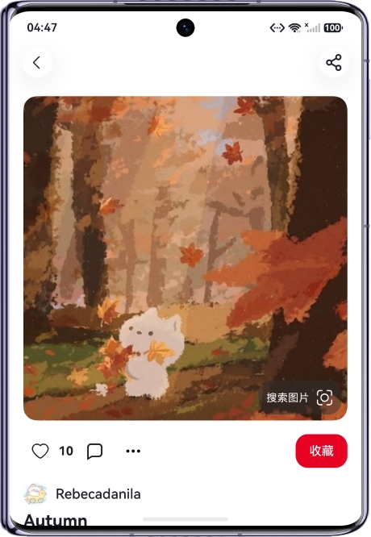

  

<h1 align="center">Pinmony</h1>

An unofficial Pinterest client for HarmonyOS

  <a href="https://github.com/Torotar/Pinmony/releases/latest">Download the latest version</a> ·
  <a href="https://github.com/Torotar/Pinmony/releases">Release notes</a> ·
  <a href="https://github.com/Torotar/Pinmony/issues">Report an issue</a>

  <a href="./README.zh-CN.md">中文</a> | <a href="./README.en.md">English</a>

Pinmony brings a native Pinterest browsing experience to HarmonyOS. Discover inspiration, search images, and save your favorite content on your phone, or browse and organize boards on tablets and wide foldable devices.

This repository provides app information, release announcements, installation packages, and issue tracking. Source code is no longer updated in this repository.

## Download and Updates

Visit **[GitHub Releases to download the latest version](https://github.com/Torotar/Pinmony/releases/latest)**, read the release notes, and download the installation package provided under **Assets**. Follow the instructions on the release page to choose the appropriate file for your device and install or update the app.

You can also go to **Settings → About** in the app and use the update option to open the GitHub releases page.

| Requirement | Details |
| --- | --- |
| System | HarmonyOS 6.1.1 (API 24) or later; API 26 or later is recommended. |
| Device | Supports phones, with layouts adapted for tablets and wide foldable devices. |
| Network | A network connection that can access Pinterest is required. |
| Sign-in | Sign in with your Pinterest account and password in the app. Google sign-in is unavailable. |

## Interface Preview

Pinmony has been adapted for phones, tablets, and wide foldable devices, with layouts for different screen sizes and orientations. The following previews show the phone interface and landscape and portrait layouts on larger devices.

### Phones

  
  &nbsp;&nbsp;
  

Search and discovery · Pin details

### Tablets and Wide Foldables

  

  

Landscape and portrait interface previews

Screenshots illustrate the interface. Actual content and layouts depend on the installed version, device dimensions, and account state.

## Features

- **Discovery and search**: browse home recommendations and categories; search Pins, boards, and topics. Search with photos, manage photo history, and identify selected image regions, or open content using Pin, board, and profile URLs.
- **Pin viewing and interaction**: view image, video, multi-image, product, and collage Pins, along with authors, comments, and related recommendations. Zoom images in full screen, browse images within feed cards and Pin details, move between Pin details from the same source, select and copy text, save Pins, and translate comments.
- **Image and video sharing**: share individual images, image groups from multi-image Pins, and video files through the system share sheet, or send Pins through the in-app contact sharing panel. If video preparation fails, the app provides feedback with an option to copy the link.
- **Profiles and boards**: browse created, saved, and collage content; search your own Pins; and adjust filters and grid density. Sort, merge, and restore boards; change covers; manage sections and collaborators; reorder Pins and sections by dragging in the board organizer; and control All Pins visibility. Switch between the new and classic profile layouts under Settings → Display Settings.
- **Publishing and organization**: edit photos, save drafts, publish image Pins and website links, and organize or move Pins.
- **Messages and contacts**: read chat messages, search contacts, and send Pins; copy or delete messages and manage conversations with swipe actions. Unread indicators highlight new messages. When the app reads new messages while in the foreground, it can send system notifications that open the corresponding chat.
- **Notifications and following activity**: view inbox updates and notification details, and browse recommended Pins and topics. Use the activity list to view following activity, follow back, open profiles, or say hello.
- **Recommendations and privacy**: browse recent activity by date and manage related recommendations, notifications, message permissions, mentions, and blocked accounts.
- **Display and playback**: configure immersive title bar lighting, light and dark themes, new or classic profile layouts, and full-photo display in Pin details. Adjust screen orientation on tablets and wide foldable devices, and control video autoplay separately for mobile data and Wi-Fi.
- **Languages and devices**: UI resources for Simplified Chinese, Traditional Chinese, US English, UK English, Japanese, Korean, Russian, Brazilian Portuguese, and Arabic, with layouts adapted for phones, tablets, and wide foldable devices.

Some features depend on the current Pinterest login session and service availability. Available actions are shown in the app.

## Common Tasks

| What you want to do | How to do it |
| --- | --- |
| Open a content link | Paste a Pin, board, or profile URL into the search box. |
| Search with an image | Select a photo or a previously used photo on the search page, adjust the recognition region, and view related results. |
| Change appearance and language | Go to Settings → Display Settings to adjust the theme, language, and profile layout. |
| Show full photos in Pin details | Enable “Show full photos in Pin details” under Settings → Display Settings. |
| View messages and activity | Open the inbox to view updates, messages, contacts, and following activity. |
| Move the board publish button | Press and hold the publish button, drag it, and dock it at an edge. |
| Check for updates | Go to Settings → About and open the GitHub releases page. |

## Feedback

Please use **[GitHub Issues](https://github.com/Torotar/Pinmony/issues)** to report problems or suggest improvements. Include the following where possible:

- App version, device model, and HarmonyOS version.
- Steps to reproduce, the expected result, and what actually happened.
- Relevant screenshots; for display issues, include the screen orientation and whether you use light or dark mode.

App settings provides options to export and clear runtime logs. Check screenshots and logs for personal information before submitting them. Do not upload passwords, Cookies, tokens, or other credentials.

### Language Support and Translation Feedback

The app provides multilingual interface resources, but some translations may be incorrect, inaccurate, or unnatural. If you encounter translation errors, truncated text, or display issues, please report them to the author through [GitHub Issues](https://github.com/Torotar/Pinmony/issues). Include the interface language, affected page, and problematic wording, with screenshots and suggested translations where possible.

If your language is not yet supported, or you would like support for a particular language to be improved, please submit a request specifying the language and region so the author can consider it for future language support and improvements.

## Privacy and Sessions

Login sessions are stored by the system ArkWeb component and used to access Pinterest content available to the current account. Credentials such as Cookies, CSRF values, and access tokens are not written to source code, the repository, or persistent business logs.

Runtime logs contain sanitized diagnostic information only. Clearing in-app logs does not delete files that have already been exported.

## Disclaimer

Pinmony is a personal-interest project and is not affiliated with, partnered with, or authorized by Pinterest or its affiliates.

When using the app, comply with applicable laws and regulations, Pinterest's terms of service, and account rules. Do not use it for infringement, bulk scraping, harassment, or disruption of the website's normal operation. The app does not guarantee content completeness, accuracy, real-time availability, or continuous service availability.

Pinterest's name and trademarks, along with images, videos, text, and other content on the platform, belong to their respective rights holders. Content shown in interface screenshots is used only to illustrate the app experience.
