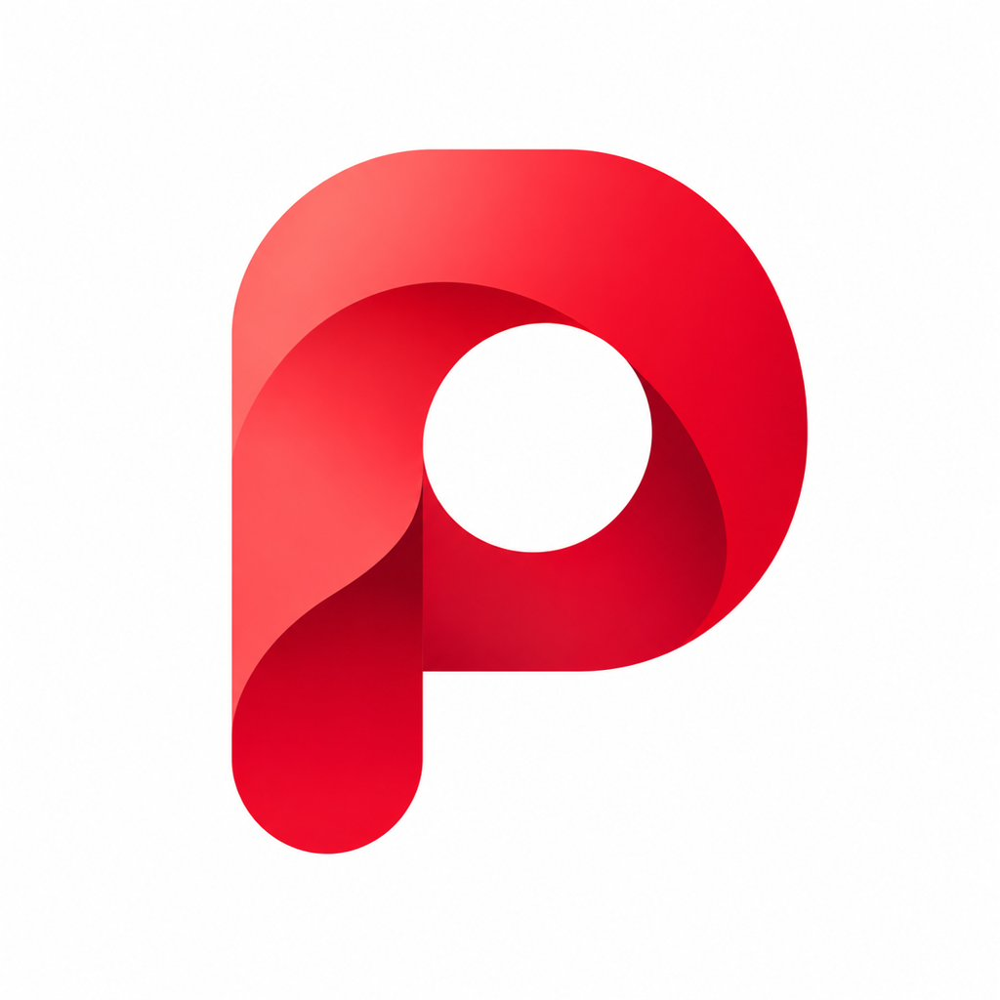
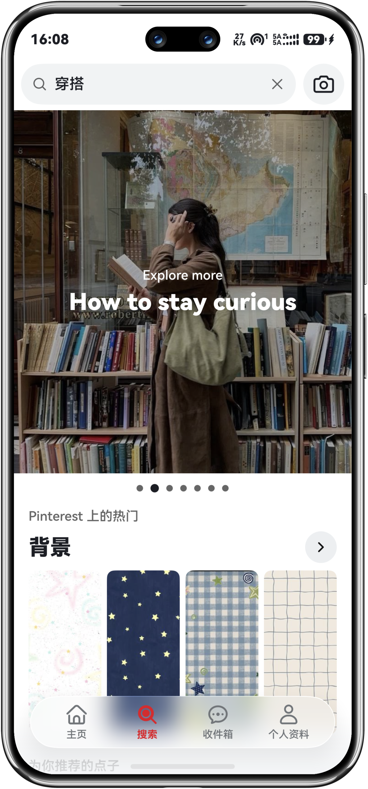
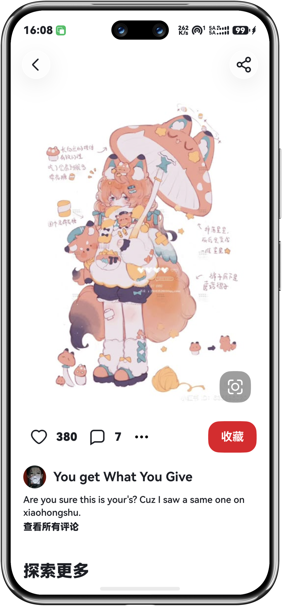
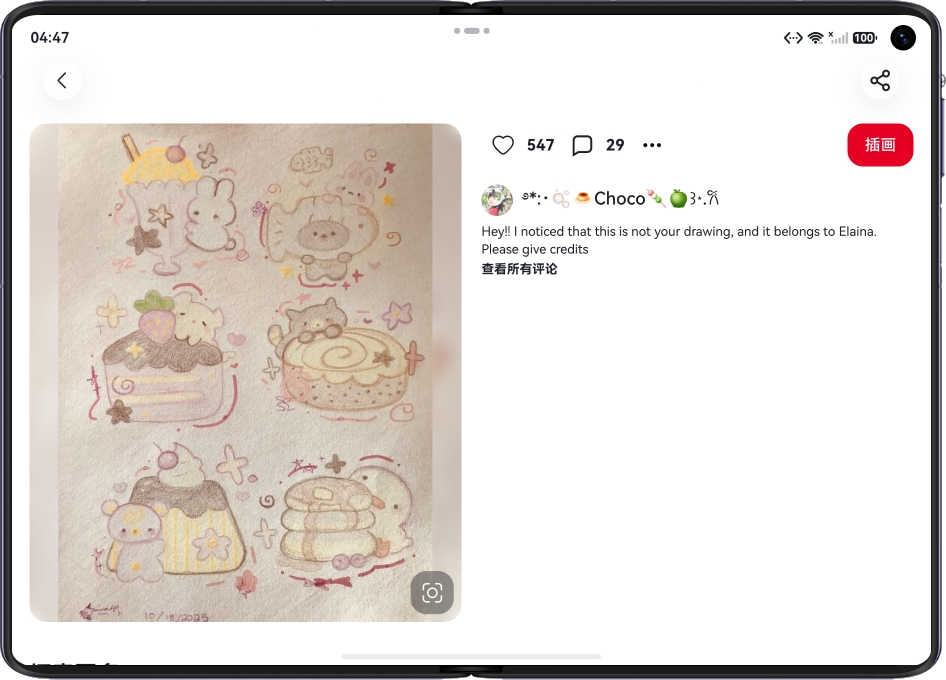
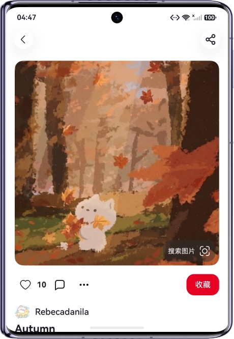

  

<h1 align="center">Pinmony</h1>

面向 HarmonyOS 的非官方 Pinterest 客户端

  <a href="https://github.com/Torotar/Pinmony/releases/latest">下载最新版本</a> ·
  <a href="https://github.com/Torotar/Pinmony/releases">更新记录</a> ·
  <a href="https://github.com/Torotar/Pinmony/issues">问题反馈</a>

  <a href="./README.zh-CN.md">中文</a> | <a href="./README.en.md">English</a>

Pinmony 为 HarmonyOS 带来原生界面的 Pinterest 浏览体验。在手机上发现灵感、搜索图片、收藏喜欢的内容，也可以在平板和阔折叠设备上浏览与整理图板。

本仓库用于应用介绍、版本公告、安装包发布与问题反馈，源码不在此仓库继续更新。

## 下载与更新

前往 **[GitHub Releases 下载最新版本](https://github.com/Torotar/Pinmony/releases/latest)**，查看版本说明并在 **Assets** 中下载该版本提供的安装包。请根据发布页说明选择适合设备的文件，完成安装或更新。

应用内也可进入 **设置 → 关于**，通过更新入口打开 GitHub 发布页面。

| 使用条件 | 说明 |
| --- | --- |
| 系统 | HarmonyOS 6.1.1（API 24）及以上版本，建议使用 API 26 及以上版本。 |
| 设备 | 支持手机，并提供平板及阔折叠设备布局适配。 |
| 网络 | 需要能够访问 Pinterest 的网络环境。 |
| 登录 | 在应用内使用 Pinterest 账号密码登录，Google 登录不可用。 |

## 界面预览

Pinmony 已适配手机、平板及阔折叠设备，并针对不同屏幕尺寸和方向调整页面布局。以下展示手机界面，以及大屏设备的横向与纵向布局。

### 手机

  
  &nbsp;&nbsp;
  

搜索与发现 · Pin 详情

### 平板与阔折叠

  

  

横向与纵向界面预览

截图用于展示界面，实际内容与布局以所安装版本、设备尺寸和账号状态为准。

## 功能

- **发现与搜索**：浏览首页推荐和分类内容，搜索 Pin、图板与主题；支持照片搜索、历史照片管理及图片局部识别，也可输入 Pin、图板或个人主页链接打开对应内容。
- **Pin 浏览与互动**：查看普通图片、视频、多图、商品和拼贴 Pin，浏览作者、评论及相关推荐；支持全屏放大、多图卡片浏览、详情内多图切换，以及同一来源的 Pin 详情前后切换，并可选择复制文本、收藏和翻译评论。
- **图片与视频分享**：可通过系统分享面板分享单张图片、多图 Pin 的图片组及视频文件，也可通过应用内联系人分享面板发送 Pin；视频准备失败时提供链接复制反馈。
- **个人主页与图板**：查看已创建、已收藏和拼贴内容，搜索自己的 Pin，调整筛选与网格密度；支持图板排序、合并、恢复、封面调整、区块及协作者管理，可在图板整理中拖动排序 Pin 和区块，并设置“所有 Pin 图”的可见性。新旧主页排版可在“设置 → 显示设置”中切换。
- **内容发布与整理**：支持照片编辑、草稿保存、图片 Pin 与网站链接发布，以及 Pin 整理与移动。
- **消息与联系人**：查看聊天消息、搜索联系人并发送 Pin，支持消息复制、删除和聊天列表侧滑管理；显示未读消息标识，应用在前台读取到新消息时可发送系统通知，并从通知进入对应聊天。
- **通知与关注动态**：查看收件箱更新及通知详情，浏览推荐 Pin 和主题内容；在“动态”列表查看关注信息、回关、进入用户主页或打招呼。
- **推荐与隐私设置**：按日期查看近期活动，管理相关内容推荐、通知、消息权限、@提及和已屏蔽账号。
- **显示与播放偏好**：提供标题栏沉浸光感、深浅色、新旧个人主页排版及详情照片完整显示设置；平板和阔折叠设备可调整屏幕方向，视频自动播放可按移动数据与 Wi-Fi 分别控制。
- **多语言与设备适配**：提供简体中文、繁体中文、英语（美国）、英语（英国）、日语、韩语、俄语、葡萄牙语（巴西）和阿拉伯语界面资源，适配手机、平板及阔折叠设备的布局。

部分功能依赖 Pinterest 当前登录会话及服务状态，实际可用操作以应用内显示为准。

## 常用操作

| 想要做什么 | 操作方式 |
| --- | --- |
| 打开内容链接 | 在搜索框粘贴 Pin、图板或个人主页链接。 |
| 用图片搜索 | 在搜索页选择照片或历史照片，调整识别区域后查看相关结果。 |
| 调整外观与语言 | 进入“设置 → 显示设置”，调整主题、语言和个人主页排版。 |
| 完整显示详情照片 | 在“设置 → 显示设置”中开启“完整显示详情照片”。 |
| 查看消息与动态 | 进入收件箱，查看更新、消息、联系人及关注动态。 |
| 调整图板发布按钮位置 | 长按发布按钮拖动，并将其停靠在屏幕边缘。 |
| 检查版本更新 | 进入“设置 → 关于”，打开 GitHub 发布页面。 |

## 问题反馈

欢迎通过 **[GitHub Issues](https://github.com/Torotar/Pinmony/issues)** 提交问题或建议。反馈时请尽量提供：

- 应用版本、设备型号和 HarmonyOS 版本。
- 复现步骤、预期结果与实际表现。
- 相关截图；涉及显示问题时，注明屏幕方向和深浅色模式。

应用设置中提供运行日志导出和清理入口。提交截图或日志前，请检查其中的个人信息，勿上传账号密码、Cookie、令牌等凭据。

### 语言适配与译文反馈

应用提供多语言界面资源，部分译文可能存在错误、不准确或不自然的表达。如遇翻译、文字截断或显示问题，欢迎通过 [GitHub Issues](https://github.com/Torotar/Pinmony/issues) 反馈给作者，并注明界面语言、所在页面和问题文字，尽量附上截图及建议译法。

如果你使用的语言尚未支持，或希望完善某种语言的适配，也欢迎提交反馈，注明所需语言及地区，供作者后续适配与完善。

## 隐私与会话

登录会话由系统 ArkWeb 组件保存，用于访问当前账号可见的 Pinterest 内容。Cookie、CSRF 和访问令牌等凭据不会写入源码、仓库或持久化业务日志。

运行日志仅保存脱敏诊断信息。清理应用内日志不会删除此前已导出的文件。

## 免责声明

Pinmony 是个人兴趣项目，与 Pinterest 及其关联方不存在隶属、合作或授权关系。

使用应用时，请遵守所在地区的法律法规、Pinterest 服务条款和账号规则，不得用于侵权、批量采集、骚扰或破坏网站正常运行的行为。应用不保证内容的完整性、准确性、实时性或服务持续可用性。

Pinterest 的名称、商标及平台中的图片、视频、文本等内容归各自权利人所有。界面截图中的内容仅用于展示应用使用效果。
