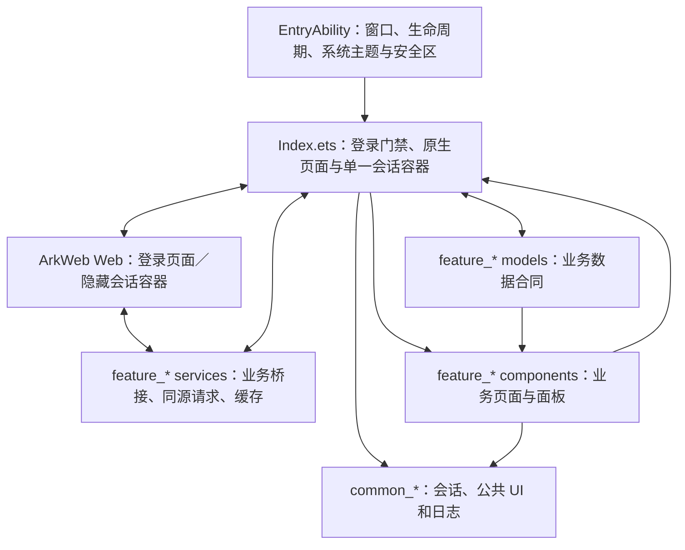

# PinWeb

2026-10-08 架构首轮优化：文档启动脚本组合与系统能力适配移入 entry/app，搜索业务验收、状态提交与流程移入 feature_search 控制器；Index 继续持有同一组 Store、Web 和四个根页。注入顺序、会话门禁、底栏首次读取及统一分享面板合同保持。阶段范围和验证边界见 [验收记录](docs/reviews/INDEX_COORDINATION_REFACTOR_20261008.md)。

2026-10-07 第二轮优化：身份晚到时补试首页磁盘缓存恢复，新网络 Feed 已提交后不覆盖；搜索输入就绪独立于内容就绪；本人资料已保存首批与 UserResource 并行，映射等待真实资料确认。新增共享 Session 与预连接诊断，未增加连接或重试。见根页优化验收记录。

2026-10-07 根页加载优化：首页“所有”Feed 与真实分类并行，分类失败不清空已成功卡片；首页分类请求不在其他业务文档附带启动。搜索分类/主题导航与同一目标的根页会话准备合并；“我的”已有快照时直接展示，操作按需准备真实会话。合成回归与 HAP 构建不证明设备加载耗时，见 [优化与验收记录](docs/reviews/ROOT_LOADING_OPTIMIZATION_20261007.md)。

首页会话恢复共用根页读取任务，在有效文档及桥接校验成功时复用当前文档；恢复阶段耗时记录在 `HomeRecoveryTrace`，真机性能需用新日志验证。

首页离线缓存支持下拉刷新手动恢复会话；恢复时保留缓存且禁用操作。证书域名不匹配时停止自动首页恢复，保留手动重试，不跳过证书校验，详见 HOME_API_NOTES.md。

PinWeb 是面向 HarmonyOS 手机的 ArkTS 应用。账号登录使用 ArkWeb；确认登录后，主页、搜索、收件箱、资料、图板、详情和面板均由 ArkUI 呈现。单一 ArkWeb 容器在后台保留网站会话与桥接上下文，已有业务接口经原生 RCP 传输适配执行；登录后不显示网页，也不接收触摸。

低栏点击只通过 `selectNativeRootTab()` 切换对应 ArkUI 根页面，不调用接口、执行 Web 导航或等待网页确认。保留页面快照与滚动；无快照且没有加载/错误状态的根页，在实际显示后的页面生命周期中自动发起首次读取，不需要先点击重试。有缓存时立即展示；“我的”已有快照时不因操作会话未确认而自动重载，主动刷新或已接入操作才准备当前资料文档并重取会话，确认前操作保持禁用。正常空结果不重复读取；快速离页会废弃尚未开始的首次读取，加载失败保留手动重试。页面内主动刷新、重试及已接入业务操作独立负责读取和必要的后台路由同步。纯画面切换期间，旧 Web 路由、详情和图板回调不能覆盖选中的页签；展示地址与真实会话地址分离，缓存不直接启用操作。

根页内容的点击意图与接口就绪分开：已展示的首页 Pin、搜索分类和主题使用快照中校验的目标地址导航，不要求隐藏 Web 停在该根页。首页分类、搜索输入/提交及收件箱分段/已接入入口，仅在用户操作时按需准备对应文档，取得新会话后重新校验并执行；快速切页会取消待执行意图，搜索输入只执行最新值，缓存会话不直接用于请求。接口分页、预取和媒体仍受真实就绪状态约束。登录流程保持不变。离线回归为 `check-root-content-actions.cjs` 与 `check-native-root-switch.cjs`；设备和线上行为需另行验证。

帖子返回沿本次原生入口链逐层返回，不借用旧搜索地址；返回父帖保留已加载的互动、推荐与滚动位置，后台重新绑定前旧控件不可操作。已认证的当前 Pin 文档提前绑定原生传输，缩短网站文档准备对基础内容确认的阻塞；推荐图保持源图比例解码后用 Cover 裁剪。相关合同及设备验证边界见 [详情接口说明](DETAIL_API_NOTES.md)。

返回时暂停旧详情文档的后续读取，并在原生分派前拦截迟到的评论/推荐请求；图片完成通知按详情身份去重。点赞数量优先使用已校验基础响应中的已有字段，缺失保持未知，仍接收当前 Pin 的有效 GraphQL 数量补充。

缓存“我的”页的帖子与图板直接按快照校验目标地址导航，返回保留原生资料来源；资料分段、资料面板、已接入的资料操作、发布选项、设置读取、搜索筛选/灵感推荐及联系人重试均在用户操作时准备当前会话。发布面板在准备文档期间保留原生加载反馈，关闭面板或设置废弃等待中的操作；设置写入不自动重放。回归入口 `scripts/check-secondary-root-context.cjs` 覆盖新会话派发、原生来源及关闭取消；登录和统一分享面板合同不变，真机与线上验证另行进行。

## 技术栈与软件框架

工程已按鸿蒙三层模块化拆分为入口 HAP 和 11 个 HAR：产品定制层 `entry`；基础特性层 `feature_home`、`feature_search`、`feature_inbox`、`feature_profile`、`feature_pin`、`feature_board`、`feature_settings`；公共能力层 `common_session`、`common_network`、`common_ui`、`common_foundation`。139 个业务状态字段归 7 个特性 Store。详细职责见 [三层架构说明](docs/ARCHITECTURE.md)，完整主题矩阵见 [ArkUI 架构完成矩阵](docs/ARKUI_ARCHITECTURE_MATRIX.md)，原生传输范围、手动回退和设备验收见 [原生网络说明](docs/NATIVE_NETWORK_NOTES.md)。基础架构统一回归入口为 `node scripts/check-foundation-architecture.cjs`，ArkUI 主题回归入口为 `node scripts/check-arkui-architecture.cjs`。

### 原生标题栏约定

图板、帖子详情、整理、设置及收件箱聊天/新消息/消息设置使用官方 HDS MINI 标题栏。顶部空间由 HDS 统一处理：Index 在这些子页显示时不再叠加状态栏高度，子页启用 `avoidLayoutSafeArea`、`enableComponentSafeArea`，并使用系统 TOP 布局安全区忽略配置。搜索框页使用专用布局。

标题栏禁用默认滚动模糊（`enableScrollEffect=false`），使用项目背景色及 `maskExtraHeight=0`；通过 `bindToScrollable` 关联正文的滚动控制器。短列表从顶部开始排列。系统 Symbol 明确设置主题色，分享图标使用带镂空圆心的轮廓路径，避免 HDS 着色将空心圆点填实。

### 分享面板固定约定

软件内只使用 Pin 详情页右上角的分享面板（`PinWebNativeShareApiOpen`、`SHARE_PANEL_BRIDGE_SCRIPT` 和原生分享半模态面板）。该面板包含当前网页会话提供的平台横向列表、发送给联系人、联系人搜索及加载提示；图板等其他分享入口必须复用同一面板。禁止改用系统 ShareKit、另造面板，或依据截图私自修改平台和操作。每次修改任意项目文件前，先查看 `AGENTS.md` 与本 README，确认这条面板规范。

常见问题是根容器和子页重复预留状态栏空间、关闭组件安全区导致正文覆盖标题、默认滚动遮罩产生大块背景，以及自定义 Symbol 未跟随主题变色。修改时必须同时核对根容器和子页；首屏、滚动后、深浅色、返回及聊天/消息设置入口需要真机复核。HAP 构建仅确认编译打包。

| 层次 | 当前技术 | 作用 |
| --- | --- | --- |
| 操作系统与应用模型 | HarmonyOS 6.1.1（API 24）、Stage 模型 | 应用生命周期、窗口、权限和页面加载 |
| 应用语言 | ArkTS | 页面协调、状态管理、桥接和业务数据映射 |
| 原生界面 | ArkUI、UI Design Kit | 原生页面、半模态面板、悬浮底栏 `HdsTabs` |
| 网页容器 | ArkWeb `Web` | 显示账号登录流程；登录后在后台保留当前网站会话 |
| 网页互操作 | 注入的 JavaScript、JavaScript Proxy | 读取网页状态、调用同源资源、把结果和操作传回 ArkTS |
| 原生媒体 | Media Kit `AVPlayer`、`XComponent` | 单视频 Pin 的原生播放和画面承载 |
| 构建 | Hvigor | 编译 ArkTS、处理资源并打包 HAP |
| 回归检查 | Node.js、`node:assert`、`node:vm`；部分检查用 TypeScript 转译 | 用合成响应检查桥接、接口映射、会话校验和过期请求处理 |

### 模块关系



`EntryAbility` 创建窗口并同步系统深浅色与状态栏安全区。`Index.ets` 保留应用级路由、Web 挂载及业务编排；各特性模块的 `services/`、`models/` 和 `components/` 分别实现数据集成、业务合同和展示。模块通过各自 `Index.ets` 导出，禁止跨模块相对路径引用或反向依赖。Pinterest 内容仍由网站和其当前会话提供，应用没有独立的 Pin 内容后端。

四个根页由全屏 `HdsTabs` 的四个 `TabContent` 承载，二级页面覆盖在 Tabs 上方。后台 Web 保持挂载且不可触摸。底栏保持 56vp 栏高和 28vp 底距，移除原有空内容底栏叠层的固定 100vp 高度。底栏收起不禁用根页触摸；四页切换不播放页面动画，返回恢复各自底栏和缓存滚动状态。

收件箱根页的“更新”和“收件箱”两个选项分别以当前 Scroll 内容高度与可视区域高度判定是否溢出；仅内容超出可视区域时，用户纵向滚动才可触发低栏收起/展开。短内容拖动、回弹和程序恢复滚动不触发收起。切换选项、内容缩短或窗口变大后不再溢出时清除该根页的收起状态并展开；二级页面仍遵循原有临时隐藏规则。`scripts/check-inbox-bottom-bar.cjs` 覆盖这些边界，设备显示和真实布局仍需真机确认。

## 登录与页面显示规则

启动直接读取 Pinterest 首页，复用 ArkWeb 自身保存的会话，不先访问登录页再导航首页。仅当网站当前会话数据明确提供已登录状态，或同源资源响应提供当前登录用户时进入原生主页；首页网址本身不是已登录证明。明确未登录时才进入登录入口，同一文档的重复判定不重复排队导航；会话未确认或首页读取失败时，手动重试仍读取首页，不按失败推断登出。已有会话仍需当前会话确认，Cookie 持久归属 ArkWeb；原生请求临时按 URL 读取，不复制到原生持久化存储或 JS 消息。

登录成功后，同一 Web 控制器保持挂载，继续为已有接口提供会话和页面上下文；已适配业务请求由原生网络执行，原有脚本保留参数构造与业务映射，只有原生页面可见。账号登录和必要的 Google/Facebook 登录跳转允许显示 Web。会话明确失效时，取消原生请求、清理四个根页、详情与子流程缓存，再返回登录页面；普通网络失败不会被当成登出。

登录桥接携带当前文档 epoch 和页面地址，拒收旧文档、旧路由及第三方响应。检查登录状态最长等待 15 秒；登录主文档连接最长等待 20 秒，超时显示重试。错误码 -100 在 SDK 中对应连接被关闭；错误显示和离线检查不能证明手机上的网络问题已解决。

“我的”页设置按钮打开原生设置子页，按用户指定顺序显示“编辑个人资料、帐户管理、个人资料可见性、优化你的推荐、显示设置、通知、退出账号、日志”。编辑个人资料接入资料读取；账号管理按用户截图呈现，个人信息的出生日期由接口返回并按截图格式显示，出生日期、性别和国家/地区三项点击无操作，详见 [账号管理接口说明](docs/ACCOUNT_SETTINGS_API_NOTES.md)。显示设置提供主题选择及底栏收起动画；优化推荐接入 AI 主题开关和近期动态首屏读取，新增个人资料可见性开关与自定义高度确认面板。动态页支持关闭此 Pin 图推荐；恢复推荐及其余未接入入口点击无操作。“退出账号”接入抓包确认的 UserSessionResource/delete，服务端业务确认后清理原生状态并进入登录页，不自动重放，详见 [退出说明](docs/SESSION_LOGOUT_NOTES.md)。标题栏和系统返回回到原资料页，设置页隐藏底栏。

资料、关注用户和关注图板读取及编辑资料保存见 [PROFILE_CONNECTIONS_API_NOTES.md](docs/PROFILE_CONNECTIONS_API_NOTES.md)。资料页头像、Created/Saved 页签、已创建 Pin、已收藏 Pin/图板和卡片目标全部由当前会话的资源接口驱动，不再读取资料 DOM 或点击网页页签。图板详情的当前用户身份、图板资料和首屏 Pin 也全部通过 `BoardResource/get`、`BoardFeedResource/get` 或 `UserResource/get` 接口读取，不使用网页初始 DOM 上下文。编辑资料完成按钮提交当前草稿，校验业务响应后刷新资料；用户名重复显示服务端错误提示。当前没有接口提交能力的发布、关注等业务操作、网页媒体回退、搜索筛选提交和 DOM 探索入口点击无操作；详情来源跳转使用 PinResource 返回的外部 HTTPS 链接。已有 API 支持的搜索结果、推荐主题、资料 Pin、图板、会话、收藏、评论读取和帖子操作继续按原合同处理。

改造前完整源码快照见 `backups/native-login-before-20261002-102059/`。先运行该目录 `restore.ps1` 校验；用户明确要求撤回时再加 `-Apply`。脚本会拒绝覆盖后续修改，恢复后需重新构建和安装。

标题栏加号的“网站、照片、图板”已接入完整原生流程：网站解析图片、多选后选择图板发布；照片使用系统选择器后选择图板发布；图板支持名称和私密设置后创建。合同、图片限制及验收边界见 [发布接口说明](docs/PUBLISH_API_NOTES.md)。

## 当前功能

- 主页、搜索、收件箱、我的四个原生底栏入口。
- 搜索发现/结果页与收件箱根页面支持顶部下拉刷新，刷新独立于普通加载状态；完成、失败或超时结束动画。
- 支持的主页动态、搜索结果/筛选/发现内容、收件箱和资料/图板界面。
- 收件箱会话支持基于当前同源接口的文字发送、消息操作、联系人屏蔽/取消屏蔽和更新处理；服务端未确认的操作不会乐观显示成功。
- Pin 详情、相关推荐、多图轮播及单视频原生播放；首页/搜索视频卡片显示接口时长并在当前可见区域静音自动播放，详情首次加载自动播放。设备解码与在线播放仍需真机验证。
- 在当前页面上下文中可用的分享、收藏、评论读取与点赞、反馈、下载及 Pin 编辑等操作。
- 系统深浅色同步、状态栏和安全区处理；登录页面加载失败或超时后的真实重试。

功能是否可用取决于当前网页、账户权限、页面会话和接口上下文。未确认或不支持的写操作（例如发表评论）应显示为不可用，不把请求发出或 HTTP 200 当作操作成功。故事页及其他未接入的媒体流程不再露出网页。没有接口实现的业务按钮和菜单保持原有视觉，点击不发请求、不转发 DOM 点击、不导航、不显示提示或成功反馈；正常页签导航、返回、输入与已接入功能继续工作。

## 数据来源与集成边界

### 自动运行日志

详情正文、主图、评论和推荐并行准备；点赞评论框架先显示，真实空评论隐藏预览，推荐保持裁剪缩略图。新增 DetailJourney 从原生点击记录各阶段、GET 尝试、评论准备等待及返回耗时；node scripts/analyze-detail-runtime.cjs <导出日志> 可展开当前会话时间线。阶段门禁、超时和测量边界见 [详情说明](DETAIL_API_NOTES.md) 与 [本次分析](docs/reviews/DETAIL_LOADING_OPTIMIZATION_20261005.md)。

资料加载失败页和登录/根页状态页均提供“导出运行日志”，无需等接口成功。设置页也保留同一入口；界面根据实际文件写入结果显示保存状态。导出文件同时包含当前和上一轮记录，保存到系统文件选择器指定的位置。USB 调试版可运行 `scripts/export-device-logs.ps1 -HdcPath '<hdc.exe 路径>'`，自动取回三份日志至电脑 `diagnostics/时间戳/`；UIAbility 文件实际位于沙箱 `data/storage/el2/base/haps/entry/files/`。

四个原生根页及登录/错误页的系统返回交由系统回到桌面；详情、图板、面板等子层先返回上一层，并短暂防止同一次关闭事件重复退出。

从 EntryAbility.onCreate 的第一步开始自动记录，逐条同步追加至应用 filesDir 下的 `pinweb-session-current.log`，无需点击保存或等退出。下次启动将此前记录保留为 `pinweb-session-previous.log`；单段按保守估算限制为 4 MiB，超限时轮转，避免长期占用存储。原有 `pinweb-runtime.log` 继续保留最近 1000 条摘要。日志包含应用/窗口生命周期、已有业务诊断、原生请求状态及可捕获未处理异常的堆栈帧；不包含凭据、请求参数或响应正文，也不是完整系统 HiLog。后台、正常销毁均记录；强制杀进程或系统崩溃可能不回调退出，已经写入的日志仍保留。文件位于应用私有目录，普通手机文件管理器不能直接访问，导出仍需系统文件选择器授权。

应用组合使用两类网站数据：

1. **Pinterest 网站内部资源：**已接入页面和操作仍使用当前 WebView 会话，业务脚本保留同源接口合同，注入适配后由 `common_network` 的应用级单例 RCP Session 执行请求。该模块以 8 路优先级调度统一请求并提供 2 次 GET 退避重试；各业务开关位于所属特性的 `services/` 对应脚本中，原生传输开关位于 `common_network`。
2. **网页会话与桥接：**隐藏 ArkWeb 只保留登录会话、Cookie/CSRF 和同源请求上下文。收件箱根页的更新、会话、联系人、分段和入口全部由 Pinterest 内部资源接口提供，收件箱桥接不读取 DOM、不注册 MutationObserver、不点击网页控件；接口失败不自动回退 DOM。其他尚未独立接口化的业务仍按各自说明处理，未接入操作不会转发网页点击，也不会显示网页流程。

这些网站内部资源不等同于 Pinterest 发布的官方开放 API。PinWeb 没有实现原生 OAuth，也没有独立的访问令牌生命周期；不把桌面 HAR 中的 Cookie、CSRF、账号 ID 或令牌写入源代码或持久化存储。需要登录时通过 Pinterest 网站在 WebView 中完成。

各功能的数据优先级、失败处理、开关和回退方式不同。很多接口开关默认启用，但请求失败时并不一定回退到旧 DOM 数据或操作；修改前应阅读对应说明：

首页三点菜单的收藏复用当前菜单已确认的 Pin 接口数据及同一网页会话用户身份，再读取收藏图板；缺失时补读完整帖子信息。读取错误区分帖子和图板阶段，非 JSON 的 401/403 不单独作为登出证据。初次读取失败显示紧凑错误与手动重试，线上可用性仍需联网设备确认。

收藏图板列表请求按已确认抓包使用独立 `www/pin/[id]/repin.js` 路由 handler，避免沿用详情或其他页面请求头；详细合同见帖子操作说明。

帖子请求的 `X-App-Version` 取自当前网页会话；首页三点菜单直接使用接口返回的 Pin 身份，返回缓存首页时不等待网页控件恢复，但仍需已登录、当前首页地址和 Pin 有效。用户主动分类切换及刷新期间禁用。

首页等待由原生两列骨架承接；DOM 就绪时提前绑定登录证据，不等网页所有资源完成。详情未加载完也能立即关闭，随后取消旧读取并通过目标导航同步真实来源；迟到路由及不属于当前目标的主框架失败不能清理当前画面。没有未完成的详情导航且控制器和 JS 地址共同确认仍为首页时，才复用原文档；真实首页连接失败保留卡片、禁用旧会话操作并提供重试。首页完成快照现在还会进入 `common_foundation` 的 LRU 和 `context.cacheDir/api_cache` 磁盘缓存，TTL 为 5 分钟，按当前会话确认的账号用户名和页面参数隔离；冷启动先恢复展示快照，再等待当前 Web 会话校验，`homeActionsReady` 仍不会由磁盘数据直接开启。会话失效、退出或账号切换清理缓存，不保存凭据。首次等待和同步超时仍为 20 秒，详见 [首页说明](HOME_API_NOTES.md)。

首页当前登录会话确认并绑定原生传输后，并行读取“所有”Feed 和当前账号的 `BoardsFeedResource/get` 分类名称、顺序与图板 ID，分类等待或失败不阻塞成功 Feed；“所有”是首个原生特殊标签。分类选中状态由原生状态和接口快照维护，不读取网页分类控件、不转发网页点击。卡片标题、图片、视频、分页和菜单/收藏入口均使用接口返回数据；接口未完成或失败时只显示原生加载、错误和重试，不回退到 DOM 卡片或控件。图板分类另外读取当前 `BoardResource/get` 摘要，在分类栏下显示真实图板缩略图、名称和 Pin 数量；摘要不阻塞首屏 Pin。实际节省时间仍需新版真机日志验证。

四个低栏按钮仅切换原生画面，日志记录 `RootTabTrace: native-switch`，并带 `mode=presentation-only webNavigation=false apiDemand=false`；点击不会调用 `PinWebSelectTab`、Web 历史跳转、页面加载或等待网络确认。首页、搜索、收件箱和资料快照及滚动继续保留；没有内容时由对应原生状态页显示未加载及重试。页面内重试/刷新才可记录 `RootTabTrace: page-read-request`，按已确认的同源地址加载隐藏业务上下文。页面重新显示不会自动启动首页预取、搜索补页或资料分页，用户正文滚动/页面操作后才恢复页面内读取。隐藏 Web 的迟到页面开始、导航、Pin 和图板状态不抢占原生页签，日志可见 `RootTabTrace: background-page-begin ignored`。帖子返回仍可使用 ArkWeb 的真实历史及前进后退文档保留（最多 4 个文档、300 秒），命中时复用已完成的文档；首页返回只同步状态，主动刷新、分类或分页才恢复首页接口读取。冻结取消在途读取，恢复重新绑定文档 epoch、会话和操作；退出禁用保留并清理历史。已显示快照不能冒充当前控制器路由，操作仍按当前会话和真实地址校验。真机速度、连续切换以及状态保持需设备验收。

网络切换导致当前根首页主框架出现 -21/-103 时，合并连续错误并在前台尝试恢复一次；后台暂停，回到前台后可再次恢复。保留卡片和滚动，旧操作须等当前 API 状态确认；恢复失败保留手动重试，正常回前台不重复加载，也不重放写操作。导航、刷新和会话变化废弃旧任务，详见 [首页恢复说明](HOME_API_NOTES.md)。真机恢复效果与冷启动耗时仍需分别验证。

首页下一页在剩余约两屏时提前读取，预取范围至少 12 张、最多 36 张。只在首页可见、应用前台、无业务面板遮挡且会话就绪时触发，恢复可用后重新检查；分页失败不因触底自动重试，保留手动入口。预取复用当前分类和真实分页游标，不通过后台切页预加载其他根页；实际等待改善需真机测量。

首页可见帖子同时提前读取详情正文与主图资源，最多 6 个候选、2 条并发，详情内存缓存最多 24 条、有效期 120 秒。点击命中后先显示标题、描述、作者与主图，现有详情链路继续确认当前操作、评论、推荐及额外媒体。预取不执行写操作或播放视频，会话失效清空；完整媒体支持边界与设备验收见 [详情说明](DETAIL_API_NOTES.md)。

详情点击后立即进入带 HDS 标题栏的原生框架，先展示卡片或内存缓存；基础 PinResource 读取在点击阶段启动，目标在途预取可移交并由当前详情文档消费，避免重复读取。正文先提交，视频/轮播独立解析；评论与推荐独立调度，首批推荐在原生基础帖子确认后提前请求，并移交当前详情桥接。评论预览等待当前会话的版本与详情 handler 就绪，最多 8 秒；失败可独立重试，不重新读取正文或推荐。主图完整显示、文字按实际溢出展开，推荐使用分段 WaterFlow 与 LazyForEach，并按用户确认继续采用缩略图裁剪。详情三点菜单通过当前 Pin 接口读取已确认选项，来源按钮仅使用接口返回的外部 HTTPS 地址，不读取或点击网页菜单和来源链接。图片失败保留正文；日志补充评论、推荐完成或失败的 openId 耗时。旧缓存不会直接启用操作，账号、地址、代次和迟到结果保护继续保留；实际提速、403 是否消失及设备显示仍需真机测量，见 [详情说明](DETAIL_API_NOTES.md)。

| 功能 | 维护说明 |
| --- | --- |
| 原生界面替换与 DOM 桥接 | [NATIVE_UI_DEVELOPMENT_NOTES.md](NATIVE_UI_DEVELOPMENT_NOTES.md) |
| 主页数据 | [HOME_API_NOTES.md](HOME_API_NOTES.md) |
| 图片放大与选区搜索 | [接入说明](docs/VISUAL_SEARCH_API_NOTES.md) |
| Pin 详情与媒体 | [DETAIL_API_NOTES.md](DETAIL_API_NOTES.md)、[多图轮播](docs/CAROUSEL_API_NOTES.md)、[视频播放](docs/VIDEO_PLAYBACK_API_NOTES.md) |
| 搜索及数据源回退 | [SEARCH_DATA_SOURCE_ROLLBACK.md](docs/SEARCH_DATA_SOURCE_ROLLBACK.md) |
| 收件箱与会话 | [INBOX_API_NOTES.md](INBOX_API_NOTES.md) |
| 资料、图板与 Pin 编辑（含标题、描述草稿） | [PROFILE_ORGANIZE_API_NOTES.md](docs/PROFILE_ORGANIZE_API_NOTES.md)、[图板选项与更多点子](docs/BOARD_OPTIONS_API_NOTES.md)、[EDIT_PIN_API_NOTES.md](docs/EDIT_PIN_API_NOTES.md) |
| 分享、评论和帖子操作 | [POST_ACTION_API_ROLLBACK.md](docs/POST_ACTION_API_ROLLBACK.md)、[评论写入与图片体验](docs/COMMENT_WRITE_API_NOTES.md) |

搜索结果分类来自当前首屏接口的 `rankedGuides`，在搜索框下横向显示；灵感入口随结果列表滚动，点击图片打开选图半模态，底部使用“查看结果”，不显示候选主题标签或“更多创意”。详见搜索数据源说明。真机交互与在线响应需另行验证。

网站内部资源、DOM 结构、GraphQL 查询哈希和页面行为都可能变化。离线回归与 HAP 构建不能证明线上服务会接受请求。视频源通过 Web 会话读取，播放由原生播放器执行；不假设原生播放器自动继承 WebView Cookie，需另行真机验证。

## 目录结构

```text
AppScope/                         应用级配置
entry/                            产品定制层（HAP）
  src/main/ets/pages/Index.ets     应用壳、Web 挂载与现有编排
  src/main/ets/app/                产品导航、Proxy 与后台底栏同步
feature_*/                        基础特性层（7 个 HAR）
  src/main/ets/components/         业务页面与面板
  src/main/ets/models/             业务合同
  src/main/ets/services/           接口脚本、桥接与缓存
common_session/                   登录会话能力（HAR）
common_network/                   原生传输与请求桥接（HAR）
common_ui/                        通用组件与深浅色资源（HAR）
common_foundation/                日志与基础能力（HAR）
scripts/                          回归检查与源码迁移路径映射
backups/                          受保护历史快照
docs/                             架构与各业务说明
```

## 开发环境

- DevEco Studio 与 HarmonyOS SDK 6.1.1（API 24）。
- 工程使用 Stage 模型，entry 模块的目标设备为手机。
- 运行时需要网络连接 Pinterest；部分功能依赖登录会话及账户权限。
- 安装签名包需要在 DevEco Studio 配置签名。本项目不包含签名配置、密钥或机器专属路径。

entry 模块声明了 `INTERNET` 和 `GET_NETWORK_INFO` 权限。

## 构建

在 PowerShell 中将 SDK 目录和 Hvigor 可执行文件路径替换为本机 DevEco Studio 安装路径：

```powershell
$env:DEVECO_SDK_HOME = '<HarmonyOS SDK 目录>'
& '<DevEco Studio 安装目录>\tools\hvigor\bin\hvigorw.bat' --mode module -p module=entry assembleHap --no-daemon
```

默认产物为 `entry/build/default/outputs/default/entry-default-unsigned.hap`。未配置本机签名时产物为未签名 HAP。

## 回归检查与验收

`scripts/check-*.cjs` 使用本地合成数据检查桥接解析、资源映射、操作门控、分页、请求顺序、缓存和过期响应。按所改功能运行对应脚本，例如：

```powershell
node scripts/check-home-api.cjs
node scripts/check-detail-api.cjs
node scripts/check-search-api.cjs
node scripts/check-inbox-api.cjs
node scripts/check-post-api.cjs
```

部分检查需用 DevEco Studio 自带 TypeScript 转译 ArkTS，并将 TypeScript 模块路径作为第一个参数；脚本报错信息或注释会指出这一要求。

请区分以下验证层次：

- **静态/离线检查：**验证代码路径、请求和响应映射、会话/Pin 校验及失败状态。
- **HAP 构建：**验证 ArkTS 编译、资源处理和安装包封装。
- **真机与线上服务：**验证实际登录会话、Pinterest 当前响应、操作结果、底栏点击和滑动、安全区、系统深浅色以及视频解码等。

不要用离线检查或构建成功代替线上服务与设备验收。界面变更需在真机检查四个底栏入口、底栏上方的滚动、返回层级、安全区、深浅色及加载/错误状态。

收件箱读取故障排查与当前分段切换就绪规则见 [INBOX_API_NOTES.md](INBOX_API_NOTES.md)；失败提示区分 HTTP、会话验证、业务状态和数据结构，离线检查不代表 Pinterest 线上可用。

收件箱会话 HTTP 403 的请求上下文修正及联网验证限制见 [INBOX_API_NOTES.md](INBOX_API_NOTES.md)。

运行诊断日志导出：[说明](docs/RUNTIME_LOG_NOTES.md)。

聊天文字发送已按2026-10-04用户HAR接入，消息反应/删除仍保持无操作；接口合同、发送结果未知的处理和回滚见 [INBOX_API_NOTES.md](INBOX_API_NOTES.md)。

聊天消息反应、本人消息删除及可确认Pin的更新订阅关闭已按用户HAR接入，操作与限制见 [INBOX_API_NOTES.md](INBOX_API_NOTES.md)。

删除更新已通过news_hub/hide/batch接口接入，详见INBOX_API_NOTES.md的合同更正。

通知读取已接入设置→通知，更新菜单复用同一原生页面；渠道开关只读，详见INBOX_API_NOTES.md。

聊天发送原生传输白名单漏项已修正（2026-10-04），原因及验证范围见 INBOX_API_NOTES.md。


2026-10-07：资料.har 已用于编辑资料读取、粉丝首批、用户关注/取消关注和用户主页分享短链/推荐联系人。主页分享复用统一面板，当前仅启用 HAR 确认的复制链接渠道；联系人发送/搜索、平台渠道和头像上传请求体未确认，保持未接入。详见 [资料与关注接口说明](docs/PROFILE_CONNECTIONS_API_NOTES.md)。

2026-10-07：搜索.har 接入 AdvancedTypeaheadResource 输入联想/最近搜索和 SearchTabResource 发现主题/轮播；结果及分页沿用 BaseSearchResource，占位提示沿用 ghost_queries。搜索 DOM 读取、网页输入/提交、滚动加载和筛选控件点击已移除，关闭接口开关也不恢复 DOM。未接入的轮播图板交互保持无操作；已知内容类型筛选和普通历史删除见下方更新；详见 [搜索数据源说明](docs/SEARCH_DATA_SOURCE_ROLLBACK.md)。线上与真机行为需另行验证。

2026-10-07：修复 SearchTabResource/get、AdvancedTypeaheadResource/get 被原生允许列表拦截的问题，仅开放 GET 读取，新增真实搜索脚本经过原生准入与 RCP 模拟的集成回归；不恢复 DOM。真机搜索发现、联想及线上响应待重新验收。

详情返回优化：5 分钟内命中完整详情缓存时恢复展示，不自动重读正文、评论和推荐；用户点击已接入操作时重新确认当前会话。同一帖子、完整请求地址匹配的评论和推荐只读成功结果可从有界内存复用。写操作、手动重试和会话失效清理此回复缓存，未命中继续正常请求。

2026-10-07 搜索操作修复：原生提交搜索先登记完整目标与准备代次，再加载隐藏搜索文档；不再由 JS 提交改变路由而遗漏原生目标。筛选器接通接口返回的已知内容类型 pins/videos/boards/users/buyable_pins，选项按当前页面校验后生成目标，关闭面板再登记导航；未知筛选禁用，不转发 DOM 控件。当前说明中“所有筛选提交无操作”的记录由此替代。日志中的 ERR_FAILED 具体原因尚未确认，需新真机日志验收，不声称已消除所有加载失败。

2026-10-07 搜索历史删除：根据删除搜索.har 接入 POST ApiResource/delete，options.url=/v3/search/recent/，提交当前历史原始 query 和 vertical=PIN。仅 recent_query 且 vertical=pins 的普通历史可删除；个人历史未确认，保持禁用。防止并发删除，校验 status=success、code=0、endpoint_name=v3_recent_search_delete 后移除确认条目并重新读取历史；失败保留条目，无自动写重放或 DOM 回退。原始查询和操作标识仅保留当前会话，过时代次/页面响应丢弃。替代此前历史删除未接入说明。静态与构建不能证明真机和线上操作成功。

2026-10-07 搜索输入状态修复：输入面板不随键盘失焦自动关闭，提交/建议选择明确收起，取消恢复完整搜索地址中的已提交关键词；正文按已提交地址选择发现/结果，不按输入草稿切换。每次打开输入面板刷新建议，独立显示建议加载和错误，不显示结果错误冒充历史错误。保留原生接口与删除业务校验、禁止写重放和 DOM 回退；新增 SearchInputTrace 脱敏面板打开日志。真机焦点/键盘/结果与历史操作仍需验收。

2026-10-08 生命周期优化：后台阻止业务原生新请求，并取消 GET/Resource get（含 POST get）的在途读取与桥接未发送任务；已发送写请求不自动重放，保留当前结果校验。网页自身请求仍不接管。前台仅为当前可见根页或详情恢复必要的读取，保留成功内容；后台废弃根页等待任务，准备等待上限 12 秒。NetworkTrace lifecycle=suspend/resume/deferred 与 BusinessLifecycle 记录脱敏状态；NavigationFailureTrace 记录当前失败的 epoch/目标/准备/前后台，未推断 ERR_FAILED 根因。真机挂起与恢复、线上操作仍需验收。

2026-10-08 主图状态补正：真实加载回调可将 timeout/failed 阶段升级为 loaded，仍校验 Pin、图片地址与呈现代次；迟到的当前图片完成证据不再被后续快照覆盖为未加载。超时本身不代表加载成功，不修改图片源或超时阈值。

2026-10-08 返回准备合并：详情返回根页时先登记同一完整目标的准备任务，根页首次内容需求加入该任务，避免再次加载。后台撤销原生排队及凭据准备中的未发送写请求；已发送图片上传保留当前结果校验，恢复不重新注册或上传。离线回归覆盖返回任务共享、12 秒等待上限、后台读取取消和上传不重放。

详情返回优先恢复完整只读缓存与滚动位置，不自动导航、重读评论和推荐；点击已接入操作入口时准备当前文档并使用新快照操作标识。原生已校验首批推荐可提前展示，当前桥接确认前不开放业务操作。返回兜底每个代次最多加载一次目标。主图按 Pin 与完整图片地址保留节点，真实完成可以更新此前的超时状态。

缓存返回后点击相关推荐，直接呈现目标帖子的缓存或卡片图片，并同步目标隐藏文档；不再先确认父帖再打开子帖。前台、已认证、原生父帖和合法目标地址门禁保留，点赞等业务操作仍使用目标当前会话的新操作标识。

详情后续修正：主图按完整来源使用 ForEach 管理实际节点，解码成功才确认 loaded；当前文档绑定去重并有界刷新快照，旧 epoch 读取及时结束，当前 Pin 仅对明确文档重绑定恢复一次。返回首页单次目标导航，避免历史回退与定时重载竞争。证书校验失败显示明确连接错误并要求检查网络/代理后重试，不推断登录失效；设备实际证书问题不由编译或离线测试证明消除。

主图缺少完成回调时最多等待 8 秒，桥接阶段超时也结束转圈并提供独立图片重试；重试更新实际图片节点代次，真实迟到解码仍可恢复成功。详情打开期间有界探测当前目标文档，减少漏触发 ready/page-end 的等待；不重新导航、不跳过会话门禁，缓存返回不自动同步。运行时异常与 Promise 拒绝分类记录脱敏源码位置，详情测量失败不打断图片初始化。回归与设备验收界限见 [详情说明](DETAIL_API_NOTES.md)。

主图进一步独立为 PinWebDetailHero，无参构建函数直接读取当前来源，避免按值 Builder 参数冻结旧地址；评论和推荐快照不重建图片，只有完整来源变化或手动重试更新节点。打开新详情废弃旧根页准备与返回任务，详情提交后继续保护当前地址；过期搜索文档和错误不清空新详情，实际文档变化仍禁用旧操作会话。离线回归与 HAP 构建不能证明本次正式图片已在设备显示，需核对新日志的节点创建和解码记录。
