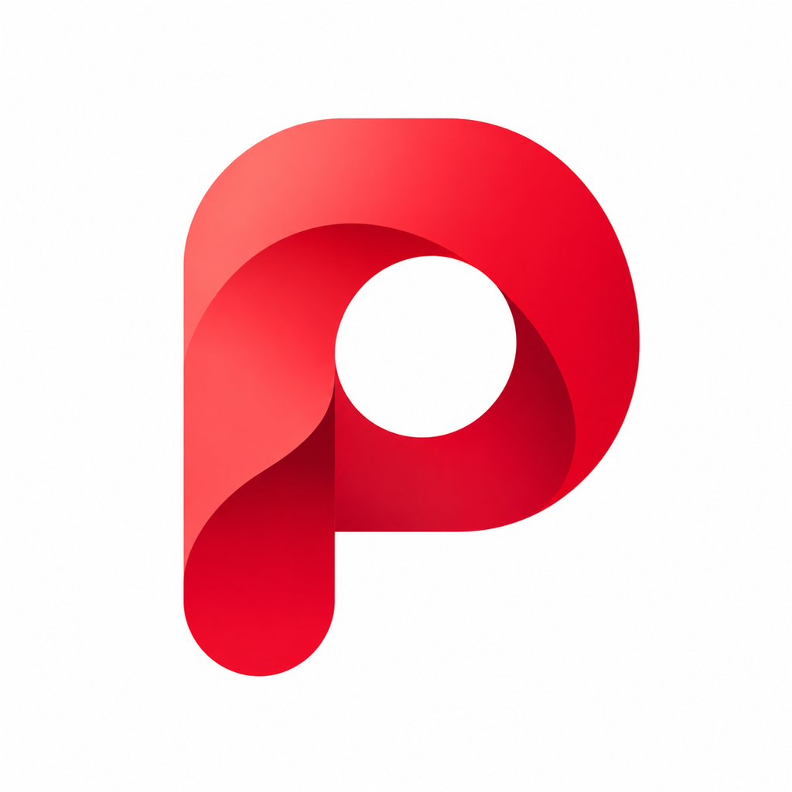

<p align="center">
  
</p>

<h1 align="center">Pinmony</h1>

<p align="center">
  <a href="./README.zh-CN.md">中文</a> | <a href="./README.en.md">English</a>
</p>

Pinmony 是个人为了兴趣开发的 HarmonyOS 应用，主要用于学习、技术研究、界面探索和移动端体验测试。账号登录使用 ArkWeb，登录后的业务界面使用 ArkUI 原生呈现。部分功能依赖当前登录会话及 Pinterest 网站内部同源资源；这些资源不是 Pinterest 官方开放 API。

## 功能

- **发现与搜索**：浏览首页推荐和分类内容，搜索 Pin、图板与主题；支持照片搜索、历史照片选择及图片局部识别。
- **Pin 浏览与互动**：查看图片、视频、作者、评论和相关推荐，支持图片放大、收藏、评论及分享。
- **个人主页与图板**：查看个人资料和已保存内容，搜索自己的 Pin；支持图板排序、合并、恢复及“所有 Pin 图”可见性管理。
- **内容发布与整理**：支持照片和网站链接发布，以及 Pin 整理与移动；图板发布按钮可长按拖动并贴边停靠。
- **消息与联系人**：查看收件箱和聊天消息，在消息与联系人之间切换，按用户名搜索联系人并发送 Pin。
- **推荐与隐私设置**：按日期查看近期活动，管理相关内容推荐、通知、消息权限、@提及和已屏蔽账号。
- **显示与播放偏好**：提供沉浸光感和显示设置，可分别控制移动数据与 Wi-Fi 下的视频自动播放。
- **多语言与设备适配**：提供简体中文、繁体中文、英语（美国）、英语（英国）、日语和韩语界面资源，支持手机和平板布局。
- **运行日志**：支持脱敏日志导出和清理，便于反馈与排查问题。

## 使用条件

| 条件 | 要求 |
| --- | --- |
| 设备与系统 | HarmonyOS 6.1.1（API 24）以上版本 |
| 网络与账号 | 可访问 Pinterest，并在应用内使用账号密码完成登录。Google 登录暂不可用。 |

应用已进行平板适配，但尚未经过平板真机测试，暂无法保证所有页面的布局和内容显示均正确。如遇显示异常、遮挡或操作问题，欢迎通过 [GitHub Issues](https://github.com/Torotar/Pinmony/issues) 反馈，并附上设备型号、系统版本、截图及复现步骤。

## 技术架构

- `entry`：应用入口、窗口生命周期、登录门禁、根页面、路由和跨页面协调
- `feature_home`：首页内容、分类、分页、缓存和首页状态
- `feature_search`：搜索发现、图片搜索、筛选、结果、分类、主题和搜索状态
- `feature_pin`：详情、评论、相关推荐、媒体、收藏和分享
- `feature_board`：图板页面、图板详情和图板内容
- `feature_profile`：个人资料、已保存内容、个人内容搜索、最近搜索、发布和整理流程
- `feature_inbox`：收件箱、消息与联系人合并页、会话搜索和通知相关页面
- `feature_settings`：设置、账号信息、语言、通知、社交权限、自动播放、显示偏好和退出登录流程
- `common_session`：登录证据、会话和凭据适配
- `common_network`：原生 RCP 网络传输和请求生命周期
- `common_ui`：跨特性复用的 UI 组件和公共展示状态
- `common_foundation`：多语言资源与偏好、缓存、日志、任务登记和基础运行时能力

## 语言资源与偏好

应用自有文案统一维护在 `common_foundation/src/main/resources/{base,zh_CN,zh_TW,en_US,en_GB,ja,ko}/element/string.json`，使用稳定资源名。目前提供简体中文、繁体中文、英语（美国）、英语（英国）、日语和韩语界面资源，语言偏好会在重启后恢复，并接入账号语言同步。网站和用户内容保持原文，仅对已确认的固定控件按语义标识显示本地文案。

语言选择入口位于“设置 → 显示设置”，支持跟随系统或手动选择语言。读取到受支持的账号语言时，应用会同步界面语言。

部分译文可能存在不准确或不自然的表达。如遇翻译、文字截断或显示问题，欢迎通过 [GitHub Issues](https://github.com/Torotar/Pinmony/issues) 反馈，并注明所用语言及对应页面。

### Release 构建

在项目根目录运行 PowerShell 命令：

```powershell
./build-release.ps1 -DevEcoHome '<DevEco Studio 安装目录>'
```

SDK 不在默认位置时，可通过 `-SdkHome '<HarmonyOS SDK 目录>'` 指定。脚本也支持读取 `DEVECO_STUDIO_HOME` 和 `DEVECO_SDK_HOME` 环境变量。

输出文件为 `release/Pinmony-release-unsigned.hap`。脚本会验证包内为 Release 模式、`debug=false`，且不含 Debug 源码映射；签名和真机测试仍需另行完成。

### 普通模块构建

```powershell
$env:DEVECO_SDK_HOME = '<HarmonyOS SDK 目录>'
$env:JAVA_HOME = '<DevEco Studio 安装目录>\jbr'
& '<DevEco Studio 安装目录>\tools\hvigor\bin\hvigorw.bat' --mode module -p module=entry assembleHap --no-daemon
```

## 隐私与会话

Pinmony 使用 ArkWeb 保留当前网站登录会话。原生网络按请求临时读取必要的 Cookie，并在需要时将 Set-Cookie 同步回当前 ArkWeb 会话。Cookie、CSRF、账号标识、访问令牌和响应凭据不会写入源码、仓库或持久化日志。

运行日志仅保存脱敏诊断信息，不记录 Cookie、CSRF、账号令牌、请求正文或完整敏感 URL。设置页提供运行日志导出和清理入口；清理应用内日志不会删除此前导出的文件。

## 免责声明

本项目与 Pinterest 及其关联方不存在任何隶属、合作或授权关系。本项目使用当前 ArkWeb 登录会话访问 Pinterest 网站内部同源资源，这些资源不是 Pinterest 官方开放 API；项目没有原生 OAuth 流程或独立令牌生命周期。所用接口来自目标网站公开页面或当前登录会话中的正常请求，不提供任何破解内容。

- 本项目不访问目标网站后台数据库，不进行注入攻击、越权访问或绕过授权。
- 本项目不会将 Cookie、CSRF、账号标识、访问令牌或其他凭据写入源码、仓库或持久化业务日志；登录会话 Cookie 由 ArkWeb 按平台机制保存。
- 使用者应遵守所在地区法律法规、目标网站服务条款和账号规则。
- 不得将本项目用于违法、侵权、批量采集、骚扰或破坏目标网站正常运行的行为。
- 本项目不保证数据完整性、准确性、实时性、接口稳定性或持续可用性。
- 使用本项目产生的账号、数据、设备或其他后果由使用者自行承担。

Pinterest 的名称、商标、网页设计、图片、视频、文本和接口返回内容归其各自权利人所有，不属于本项目许可证的授权范围。项目 Logo、第三方依赖和示例资源可能适用各自独立的版权或许可证条款。

## 许可

Pinmony 源代码采用 Apache License 2.0，许可证全文见 [`LICENSE`](LICENSE)。Apache-2.0 仅适用于本项目明确声明为项目代码的部分，不授权 Pinterest 的品牌、网站内容、接口数据或第三方资源。
